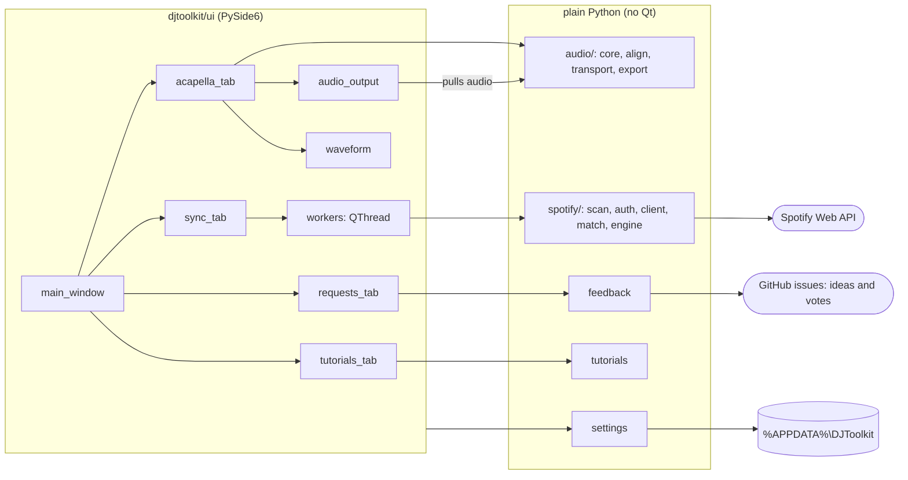

# Architecture

A Qt shell around plain-Python logic. The logic never imports Qt, so it's quick to test and easy to reason about.

## The rules that keep it this shape

- `audio/`, `spotify/`, `settings.py`, `tutorials.py` and `feedback.py` don't import Qt or the UI (a guardrail test checks).
  They report through callbacks: `run_sync(settings, dry_run, log=..., progress=..., cancelled=...)`.
- Slow work (loading audio, tempo analysis, everything Spotify) runs off the UI thread in `ui/workers.py`
  (`Task` for one call, `SyncWorker` for a sync), which turns results and errors into Qt signals.
- Colours, fonts and spacing come from `ui/theme.py`. Widgets that paint themselves subscribe with
  `theme.subscribe(fn)` and repaint when the look changes.

## Acapella prep

1. `core.load_audio` reads the file; `core.detect_bpm` suggests a tempo (a suggestion only: acapellas have no drums).
2. `align.suggest_beats` puts four beats in the loudest eight bars, and `align.refine_to_onsets` snaps them to attacks.
3. The user checks by ear and drags. `align.fit_grid` fits tempo and phase through the four beats (least squares),
   so four careful clicks beat any detector. The start snaps to that grid.
4. `transport.Transport` renders audio on demand: play, loop the four beats, a click on the grid, and scratching
   (output speed follows the hand). `ui/audio_output.py` connects it to the speakers with a pull-mode `QAudioSink`.
5. `core.prepend_countin` adds the count-in so the start lands on the beat after it; `export.write_audio` writes WAV,
   FLAC or MP3 (through ffmpeg) and tags the BPM.

## Spotify sync

`engine.run_sync` does it all, in order:

1. `scan.scan_library`: each top-level folder is a playlist; artist and title come from tags, or from "Artist - Title".
2. `auth.get_access_token`: PKCE through a short-lived listener on `127.0.0.1`; only the refresh token is saved.
3. `match.match_track`: remembered searches first (no Spotify searches used), then fresh ones within the per-run
   limit. A score (60 % title, 40 % best artist, Sørensen–Dice on normalised text) must pass *Match strictness*.
4. `engine.plan_genre`: the difference that makes each playlist equal its folder.
5. `engine.apply_plan`, only when it's not a preview. Safety: if any track is still waiting for a search, nothing is
   synced, because a half-matched folder would look like removed tracks. In the UI, *Sync playlists* stays disabled
   until a preview has run.

`client.SpotifyClient` spaces requests out, backs off on 429, stops on long cooldowns, and remembers every search in
`search-cache.json`.

## State

`Settings` (a dataclass) is the app's memory, saved as JSON in `%APPDATA%\DJToolkit\settings.json`. Unknown keys are
ignored and missing ones get defaults, so old files keep working. Per-file work is keyed by path and checked against
the file's size and modified time (`remember_file` / `recall_file`). `nearest_existing_dir` gives every dialog a
folder that exists. The token, the search memory, reports and the tutorial posts sit next to it.

## Where to change what

| Want to change | Edit |
|---|---|
| Colours, fonts, spacing, Booth/Daylight, accents | `djtoolkit/ui/theme.py` (then `pytest tests/test_theme.py`) |
| Wording | `docs/ux/VOICE.md` first, then the strings it points to |
| The alignment model (grid, start) | `djtoolkit/audio/align.py` |
| Playback, loop, click, scratch | `djtoolkit/audio/transport.py`, `djtoolkit/ui/audio_output.py` |
| The tempo suggestion | `audio/core.py` (`detect_bpm`), `audio/align.py` (`suggest_beats`, `refine_to_onsets`) |
| Count-in sound, export formats, tags | `djtoolkit/audio/core.py`, `djtoolkit/audio/export.py` |
| Spotify matching and sync | `djtoolkit/spotify/match.py`, `engine.py` |
| What is remembered | `djtoolkit/settings.py`, `djtoolkit/ui/dialogs.py` |
| Tutorials | `assets/tutorials/tutorials.json` (one sentence and 2 to 4 short steps; a test enforces it) |
| The discussion backend | `djtoolkit/tutorials.py` (the `Forum` interface; `LocalForum` today) |
| Spotify setup guide text and images | `djtoolkit/ui/setup_guide.py`, `tools/make_setup_images.py`, `assets/setup/real/` |
| Requests: the ideas list and the GitHub forms | `djtoolkit/feedback.py`, `djtoolkit/ui/requests_tab.py` |
| Where the app keeps its data, per system | `djtoolkit/settings.py` (`app_dir`) |
| The downloadable app | `packaging/dj-toolkit.spec`, `main.py` (`--self-test`), `.github/workflows/release.yml` |
| The landing page | `website/` (see `website/AGENTS.md`) |
